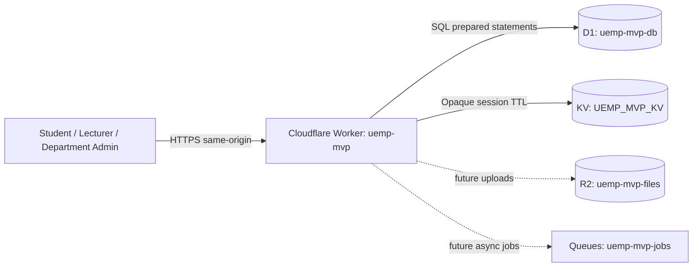
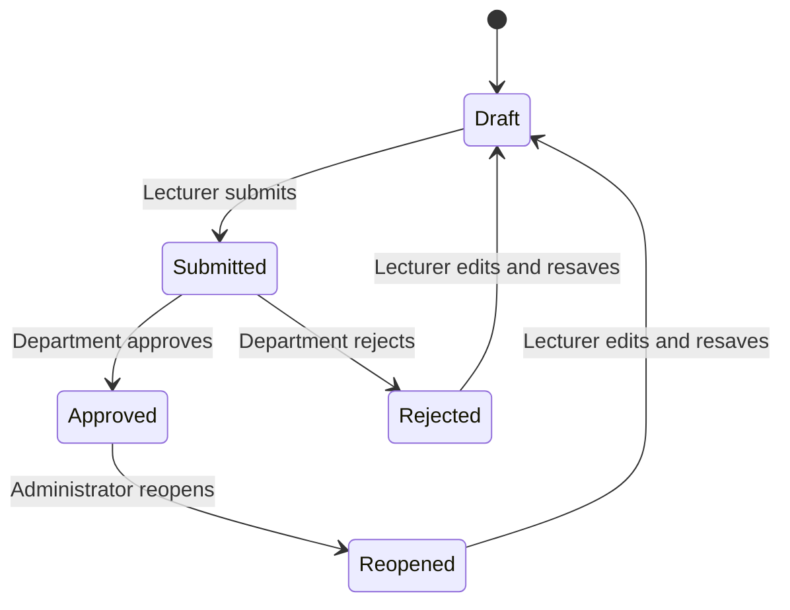

# Architecture and operational notes

## Runtime topology

The Worker serves the application shell and API from one origin. The browser does not connect directly to D1 or KV. All authorization and validation occur in the Worker.

## Authentication and authorization

- Passwords are verified using PBKDF2-HMAC-SHA256 with 310,000 iterations and a per-seed salt.
- Successful login creates a cryptographically random opaque session identifier.
- The cookie is HttpOnly, Secure, SameSite=Lax, and scoped to the application path.
- Session records are stored in KV with an eight-hour expiration.
- The API resolves the session server-side and checks the user's role before each protected operation.
- Department administrators are restricted to records belonging to their department for review operations.
- Lecturers can only access course offerings assigned to their account.

## Results lifecycle

Student result queries include only submissions with status `approved`. Lecturer edits are rejected while a submission is submitted or approved. Administrative review actions are recorded in `audit_logs`.

## Data integrity

- Foreign keys connect users to departments, students to programmes, offerings to courses and semesters, and result entries to submissions and students.
- `UNIQUE(student_id, offering_id)` prevents duplicate course registrations.
- `UNIQUE(course_id, semester_id)` prevents duplicate offerings of a course in the same semester.
- Score columns and API validation enforce CA 0–30, exam 0–70, total 0–100.
- Grades and grade points are read from the grading scale table.
- Result writes use D1 batch operations and append an audit event.

## Environment bindings

| Binding | Resource |
|---|---|
| `DB` | D1 database `uemp-mvp-db` |
| `KV` | KV namespace `UEMP_MVP_KV` |

R2 and Queue are provisioned but are not bound into the first deployed Worker version.
