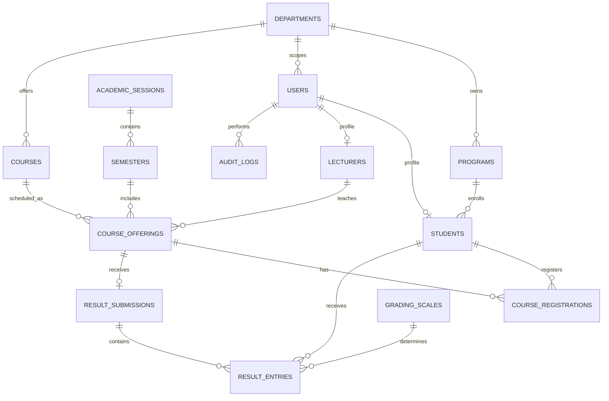

# Entity relationship diagram

Core entities: departments, programmes, academic sessions, semesters, users, students, lecturers, courses, course offerings, course registrations, grading scales, result submissions, result entries, audit logs and application settings.
